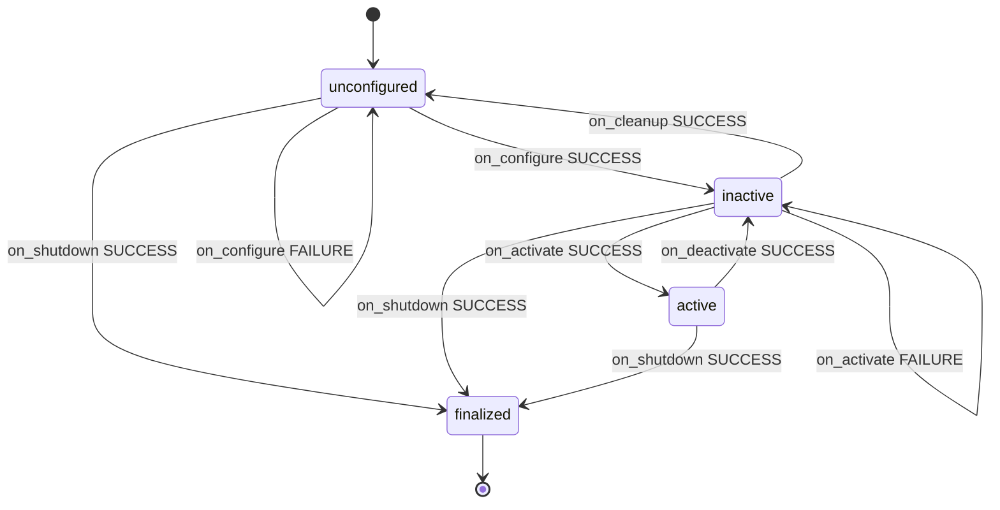

# Controller states and transitions: unconfigured, inactive, active, finalized

**TL;DR** Every controller and broadcaster is a lifecycle node. The controller manager stores its state and triggers its transitions, so it can make sure the hardware is ready before commands are accepted, and restart or switch controllers online. A controller moves the robot only when it is **active**.

## States and transitions

- Six transition callbacks: `on_configure`, `on_cleanup`, `on_activate`, `on_deactivate`, `on_shutdown`, `on_error`.
- Each callback returns `SUCCESS`, `FAILURE` or `ERROR` (`CallbackReturn`), and the controller manager reads the result to decide the new state. `ERROR` (or an exception) is not drawn above: it goes to the transition state `ErrorProcessing`, which calls `on_error`.

## What each state allows
| State | How you get there | What you see |
|---|---|---|
| unconfigured | `load_controller` | no topics of the controller yet: publishers and subscribers are created in `on_configure` (no `/dynamic_joint_states`, no `/forward_position_controller/commands`) |
| inactive | configure, or deactivate an active one | topics exist, but the controller manager does not call its `update()`: commands do not reach the joints [≥Jazzy: the forward controller logs "Can't accept new commands. Controller is not active."]; a broadcaster does not publish |
| active | activate | `update()` runs every control cycle: a controller moves the joints, a broadcaster publishes |
| finalized | shutdown (when the controller is destroyed) | nothing: the controller is gone |

Check the state with `ros2 control list_controllers` ([[control-cli-list]]); change it from the CLI, the services or the spawner ([[control-cli-state-changes]], [[control-services-spawner]]).

## Pitfalls
- Robot ignores commands, no error → the controller is `inactive`, or the topic exists only because it was configured: check `list_controllers`.
- A topic you expect is missing → the controller is still `unconfigured` (loaded, not configured).
- If you do not know the states, you cannot tell which situation caused an error, or you may not notice a problem at all: look at the state first when debugging.
