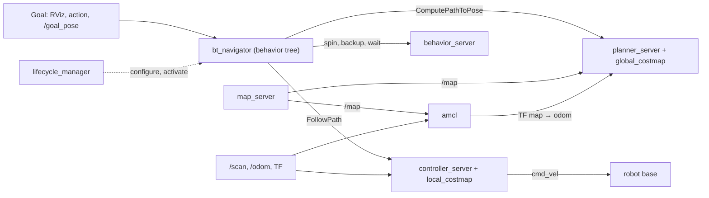

# Nav2 architecture: navigation tasks and servers

**TL;DR** To go from A to B a robot must map, localize, plan and control while avoiding obstacles. Nav2 (the successor of the ROS Navigation Stack) gives one lifecycle-managed server per task, coordinated by `bt_navigator`.

## How robots navigate
To move from one point to another, a robot must:
- Map the environment (**Mapping**): create or access a map of its surroundings ([[nav2-map-concepts]]).
- Determine its location (**Localization**) within that map ([[nav2-amcl-concepts]]).
- Plan a route (**Path Planning**): the best way between two points ([[nav2-planner-server]]).
- Execute the movement while avoiding obstacles (**Robot Control** & **Obstacle Avoidance**): send commands to the wheels (or other actuators) to follow the path while detecting and avoiding obstacles in real time ([[nav2-controller-server]], [[nav2-costmap-concepts]]).

## What Nav2 provides
| Task | Nav2 component | Package / executable |
|---|---|---|
| Mapping: load, serve and store maps | Map Server | `nav2_map_server` / `map_server`, `map_saver_cli` |
| Localization: robot pose on the map | AMCL | `nav2_amcl` / `amcl` |
| Path planning: path from A to B avoiding obstacles | Nav2 Planner | `nav2_planner` / `planner_server` |
| Path execution: follow the path | Nav2 Controller | `nav2_controller` / `controller_server` |
| Obstacle awareness from sensor data | Nav2 Costmap 2D | `nav2_costmap_2d` (inside planner and controller) |
| Recovery behaviors when navigation fails | Nav2 Behaviors | `nav2_behaviors` / `behavior_server` |
| Lifecycle of the navigation servers | Nav2 Lifecycle Manager | `nav2_lifecycle_manager` / `lifecycle_manager` |
| Customization with plugins and behavior trees | Nav2 BT Navigator | `nav2_bt_navigator` / `bt_navigator` |

## Data flow

The lifecycle manager starts every server above, not only `bt_navigator` ([[nav2-lifecycle-manager]]). Official diagram: [navigation2 repository](https://github.com/ros-navigation/navigation2). cmd_vel chain per distro, TF and topic rates: [[core-nav2-overview]].

## Pitfalls
- Launching the servers without a lifecycle manager → they stay unconfigured and nothing happens.
- Check `map → odom → base_link` and `/scan` before tuning anything ([[core-tf-basics]]).
