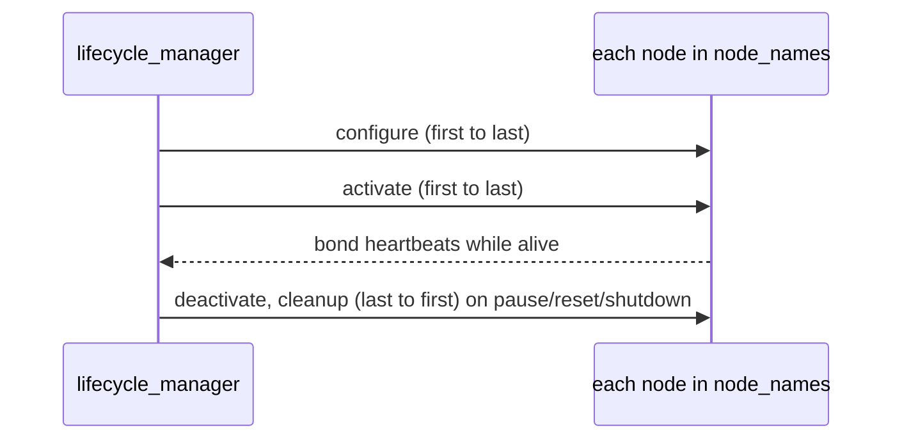

# nav2_lifecycle_manager: node_names, autostart, bonds

**TL;DR** Nav2 servers are **managed (lifecycle) nodes**: they start `unconfigured` and do nothing until an external agent moves them to `active`. In Nav2 that agent is `nav2_lifecycle_manager`: it configures and activates the nodes in `node_names`, in order.

## Managed nodes in Nav2
Managed nodes can be restarted, paused or run in a controlled way. States: `unconfigured`, `inactive`, `active`, `finalized`; the usual state is `active` (running its main code and timers). Several Nav2 nodes are lifecycle enabled: `map_server`, `amcl`, `planner_server`, `controller_server`, `bt_navigator`, `behavior_server`… They override `on_configure()`, `on_activate()`, `on_deactivate()`, `on_cleanup()`, `on_shutdown()` and `on_error()`. State machine and CLI: [[core-lifecycle-concepts]].

## What the lifecycle manager does
- Changes the states of the managed nodes for a controlled **startup, shutdown, reset, pause or resume** of the navigation stack.
- Nav2 nodes use the `nav2_util` `LifecycleNode` wrapper, which hides lifecycle complexity and adds a **bond** to the manager: after a node goes up, the manager knows it stays alive. If a node crashes, the manager transitions the system down to prevent a critical failure.
- It offers the service `<manager node name>/manage_nodes` to drive the whole stack from the CLI or your programs ([[nav2-lifecycle-manage-nodes]]).



## Launch snippet and parameters
```python
Node(package='nav2_lifecycle_manager', executable='lifecycle_manager', name='lifecycle_manager',
     output='screen',
     parameters=[{'autostart': True},
                 {'node_names': ['map_server', 'amcl', 'controller_server', 'planner_server',
                                 'recoveries_server', 'bt_navigator']}])
```
| Parameter | Default | Meaning |
|---|---|---|
| `node_names` | (required) | nodes to manage; the order is the startup order (shutdown in reverse) |
| `autostart` | false | configure and activate the nodes as soon as they are loaded. **Set it to True** |
| `bond_timeout` | 4.0 s | time without heartbeat before a node counts as crashed; `0.0` disables bonds |
| `attempt_respawn_reconnection`, `bond_respawn_max_duration` | true, 10.0 s | reconnect to a respawned node |

## Pitfalls
- A node missing from `node_names`, or with a different name (namespace included), stays `unconfigured`.
- One node failing to configure aborts the startup of all of them: read the first error in the log.
- `bond_timeout: 0.0` (used in the course's multi-robot setup) also disables crash detection ([[nav2-multirobot-localization]]).
